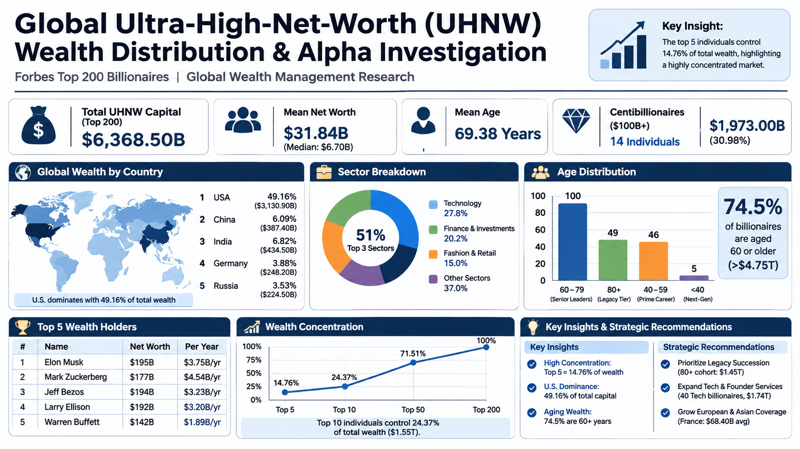
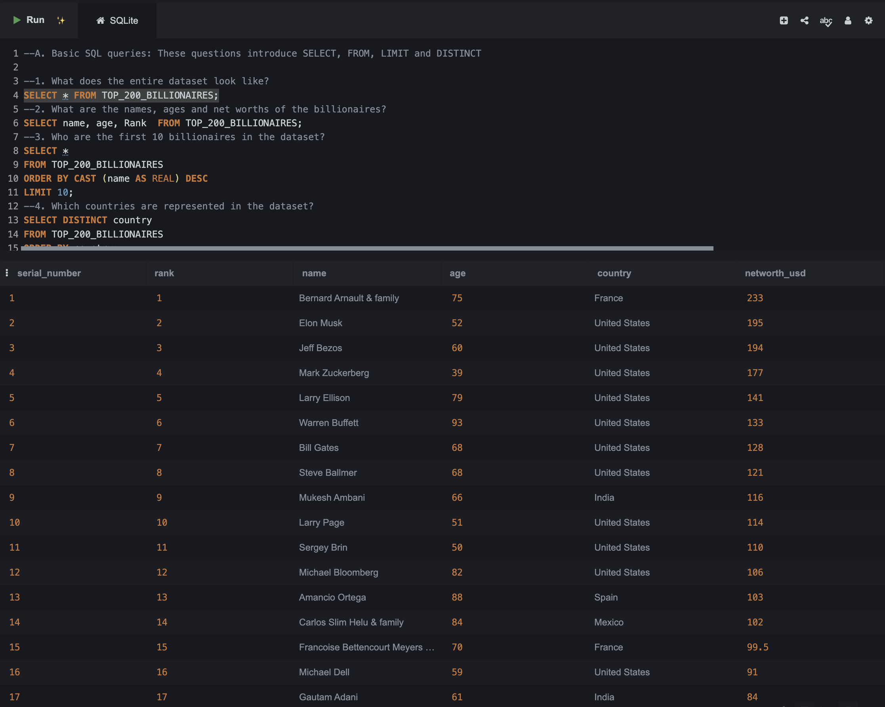
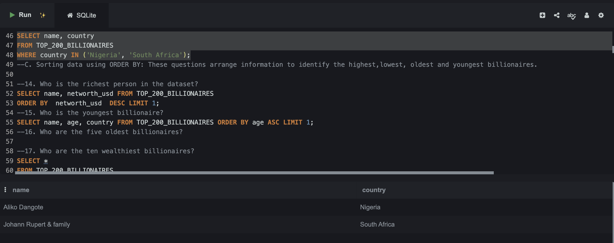
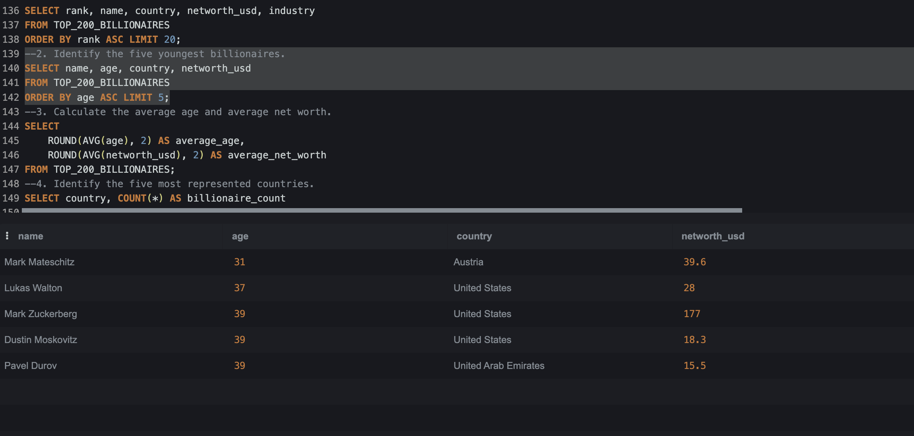
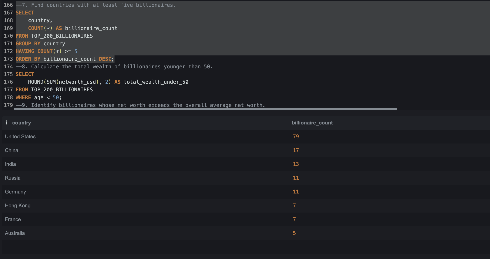
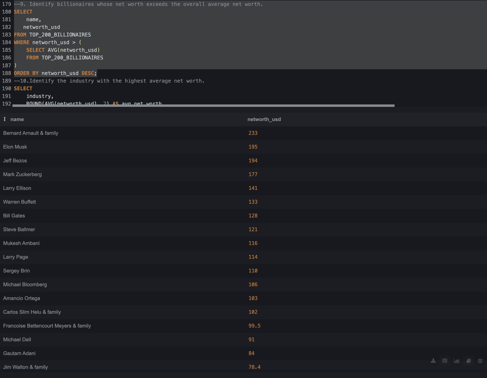
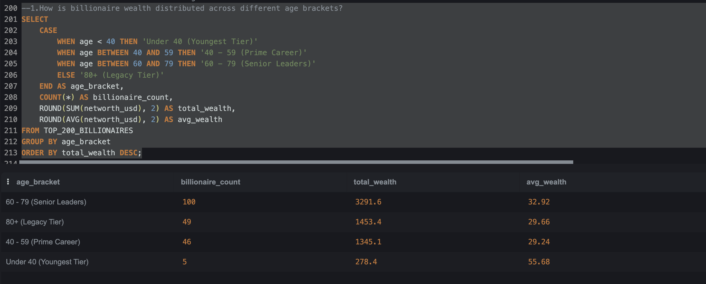
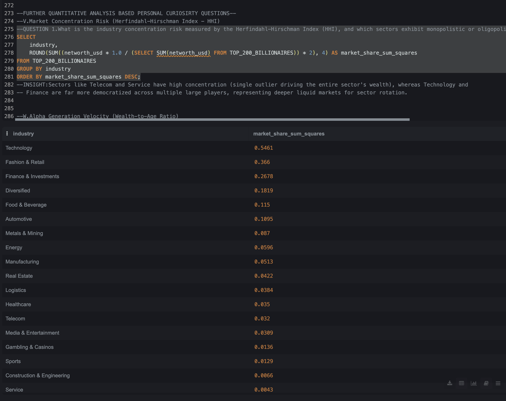
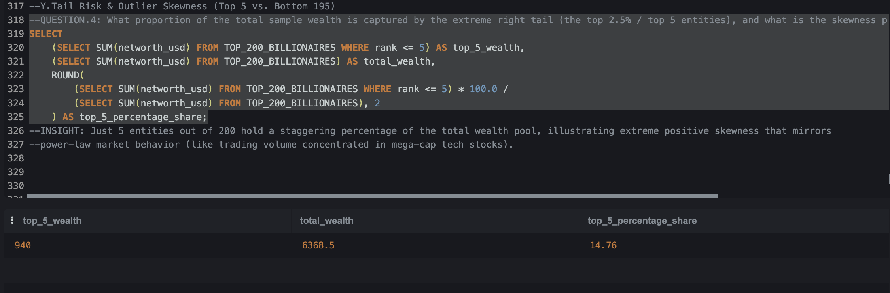

# GLOBAL ULTRA HIGH NET WORTH (UHNW) WEALTH DISTRIBUTION & ALPHA INVESTIGATION 🏦📊

**Author:** Elisha Alal  
**Role:** Data Analyst, UEFI Global  
**Tools:** SQL (Microsoft SQL Server / SQLite / PostgreSQL), Relational Data Modeling, Quantitative Statistical Analysis  
**Dataset:** Forbes Top 200 Global Billionaires [***TOP 200 BILLIONAIRES***](TOP_200_BILLIONAIRES.csv)


---

## 📊 Dashboard & Initial Dataset Exploration



---

## 📑 Table of Contents

- [Project Overview](#project-overview)
- [Business Problem](#business-problem)
- [Project Objectives](#project-objectives)
- [Analytical & Business Questions](#analytical--business-questions)
- [Dataset Description & Schema](#dataset-description--schema)
- [Tools and Technologies](#tools-and-technologies)
- [Data Exploration and Methodology](#data-exploration-and-methodology)
- [SQL Analysis Screenshots & Execution](#sql-analysis-screenshots--execution)
- [Key Findings and Insights](#key-findings-and-insights)
- [Geographical Analysis](#geographical-analysis)
- [Industry Analysis](#industry-analysis)
- [Quantitative & Risk Analytics (Quant Perspective)](#quantitative--risk-analytics-quant-perspective)
- [Strategic Wealth Management Recommendations](#strategic-wealth-management-recommendations)
- [Repository Structure](#repository-structure)
- [How to Explore the Project](#how-to-explore-the-project)
- [Assumptions and Limitations](#assumptions-and-limitations)
- [Conclusion](#conclusion)
- [Author](#author)

---

## 🏢 Project Overview

This project explores the world's 200 richest people using structured SQL querying and relational data analysis. Operating from a Global Wealth Management perspective, the investigation examines billionaire wealth distribution, age demographics, geographical representation, sector concentration, and macro market behavior.

Using a dataset containing 200 billionaire records, the project investigates patterns in individual net worth, country representation, industry dominance, and demographic characteristics. The analysis applies SQL querying, filtering, sorting, aggregate functions, grouping, conditional logic, window functions, and subqueries to extract actionable intelligence.

---

## 💼 Business Problem

Understanding global wealth distribution requires examining more than individual net worth rankings. Geographic location, industry representation, and demographic characteristics provide essential perspectives on how extreme capital and market liquidity are distributed.

This project uses SQL to investigate the characteristics of the world's 200 richest individuals, addressing core business scenarios in wealth management, market concentration risk, and intergenerational asset transfer.

---

## 🎯 Project Objectives

- Explore the structural characteristics of the world's 200 richest individuals.
- Identify the wealthiest and least wealthy entities in the dataset.
- Examine billionaire age distribution and multi-generational succession pipelines.
- Identify countries and regional economic clusters with the highest representation.
- Compare billionaire representation and total asset concentration across industries.
- Calculate total and average net worth alongside dispersion metrics.
- Investigate quantitative risk metrics, alpha generation velocity, and tail risk concentration.

---

## ❓ Analytical & Business Questions

The SQL investigation answers a comprehensive battery of analytical questions across multiple domains:

### 1. Core Wealth & Demographic Analysis
1. Who are the 20 richest billionaires in the dataset?
2. Who are the five youngest and five oldest billionaires?
3. What is the overall combined net worth, average net worth, and average age?
4. Which billionaires exceed the dataset's overall average net worth?
5. What is the total wealth and percentage share of billionaires younger than 50?
6. What is the wealth spread between the richest and least wealthy billionaire?

### 2. Geographical & Industry Analysis
1. Which countries are represented, and which five countries have the highest billionaire count?
2. What is the combined and average net worth of billionaires in each country?
3. Which countries have at least five billionaires represented?
4. Which five industries have the highest number of billionaires?
5. Which industry has the highest combined wealth, and which has the highest average net worth?

### 3. Quantitative & Wealth Management Questions
1. How is wealth segmented across generational cohorts (Under 40, 40–59, 60–79, 80+)?
2. What percentage of total wealth is controlled by the Top 5 and Top 10 individuals (Tail Risk)?
3. How much capital is controlled by multi-generational family dynasties (`& family`)?
4. Which countries dominate the Centibillionaire tier ($100B+)?
5. Who leads globally in Alpha Generation Velocity ($\text{Net Worth} / \text{Age}$)?

---

## 🗂️ Dataset Description & Schema

- **Dataset Source:** Forbes Top 200 Richest World's Billionaires Dataset (Kaggle)
- **Dataset Format:** CSV (`TOP_200_BILLIONAIRES.csv`)
- **Number of Records:** 200
- **Number of Columns:** 7

### Column Specifications

| Column Name | Data Type | Description |
| :--- | :--- | :--- |
| `serial_number` | `INTEGER` | Sequential record identifier (1–200) |
| `rank` | `INTEGER` | Global Forbes wealth ranking |
| `name` | `TEXT` | Principal billionaire or family dynasty name |
| `age` | `INTEGER` | Current age of the primary wealth holder |
| `country` | `TEXT` | Primary country of citizenship / residence |
| `networth_billion_US_dollars` | `REAL` | Total net worth expressed in USD Billions |
| `industry` | `TEXT` | Primary sector of wealth generation |

---

## 🛠️ Tools and Technologies

- **Microsoft SQL Server / SSMS / SQLite / PostgreSQL:** Primary database engines for executing relational queries, filtering, aggregation, and window functions.
- **SQL / T-SQL:** Language utilized for data extraction, subqueries, CTEs, and metric calculation.
- **Git & GitHub:** Version control and portfolio documentation.

---

## 🔍 Data Exploration and Methodology

The analysis followed a structured analytical workflow:

1. **Initial Data Exploration:** Inspecting table structures, row counts, and data types using `SELECT *`.
2. **Filtering & Conditional Logic:** Applying `WHERE`, `BETWEEN`, `IN`, and `LIKE` to isolate target demographics (e.g., under 40, specific countries, family trusts).
3. **Sorting & Ranking:** Utilizing `ORDER BY` and `LIMIT` / `TOP` to establish elite wealth rankings.
4. **Aggregate Analysis:** Deploying `COUNT()`, `SUM()`, `AVG()`, `MAX()`, and `MIN()` for macroeconomic baseline figures.
5. **Grouped Analysis:** Using `GROUP BY` and `HAVING` to summarize metrics across countries and industry sectors.
6. **Advanced Quantitative Modeling:** Implementing subqueries, Common Table Expressions (CTEs), `CASE WHEN` segmentation, and Window Functions (`RANK() OVER`) to analyze market concentration and wealth velocity.

---

## 🖼️ SQL Analysis Screenshots & Execution

The following visual evidence documents the SQL queries executed and their corresponding outputs:

### 1. Initial Dataset Exploration


### 2. Country Filtering & Regional Queries


### 3. Demographic & Age Extremes


### 4. Above-Average Net Worth Subquery Analysis


### 5. Under-50 Cohort & Percentage Share


### 6. Wealth Extremes & Range Spread


### 7. Industry Representation & Threshold Filtering


### 8. Advanced Aggregations & Grouped Summaries


---

## 📈 Key Findings and Insights

### 1. Overall Wealth Distribution

| Metric | Result |
| :--- | ---: |
| Total Billionaires | 200 |
| Combined Net Worth | $6,368.50 Billion |
| Average Net Worth | $31.84 Billion |
| Highest Net Worth (Bernard Arnault & family) | $233.00 Billion |
| Lowest Net Worth | $10.70 Billion |
| Wealth Spread (Max - Min) | $222.30 Billion |

### 2. Demographic & Age Breakdown

| Metric | Result |
| :--- | ---: |
| Average Age | 69.38 Years |
| Youngest Billionaire (Mark Mateschitz) | 31 Years |
| Oldest Billionaire (Robert Kuok) | 100 Years |
| Billionaires Younger Than 50 | 16 (8.0% of dataset) |
| Combined Wealth Under Age 50 | $508.30 Billion |

### 3. Generational Segmentation & Succession Pipeline

| Generational Tier | Principal Count | Combined Wealth ($B) | Average Net Worth ($B) |
| :--- | :---: | :---: | :---: |
| **60 – 79 (Senior Leaders)** | 100 | $3,291.60B | $32.92B |
| **80+ (Legacy / Succession Tier)** | 49 | $1,453.40B | $29.66B |
| **40 – 59 (Prime Career)** | 46 | $1,345.10B | $29.24B |
| **Under 40 (Next-Gen Disruptors)** | 5 | $278.40B | $55.68B |

- **Succession Opportunity:** **74.5% of the dataset (149 principals)** are aged **60 or older**, representing **$4,745.00B** in assets requiring active intergenerational wealth transfer and estate advisory.
- **Family Dynasty Footprint:** **43 entries** explicitly operate as multi-generational family offices (`& family`), controlling **$1,507.80B** (averaging **$35.07B**—exceeding the overall dataset mean of $31.84B).

---

## 🌍 Geographical Analysis

Wealth among the top 200 is heavily concentrated in North America and major economic hubs. Only **8 countries** host five or more top-200 billionaires:

| Rank | Country | Billionaire Count | Combined Wealth ($B) | Average Wealth / Principal ($B) |
| :--- | :--- | :---: | :---: | :---: |
| 1 | **United States** | 79 | $3,130.90B | $39.63B |
| 2 | **China** | 17 | $387.40B | $22.79B |
| 3 | **India** | 13 | $434.50B | $33.42B |
| 4 | **Germany** | 11 | $248.20B | $22.56B |
| 5 | **Russia** | 11 | $224.50B | $20.41B |
| 6 | **France** | 7 | $478.80B | $68.40B |
| 7 | **Hong Kong** | 7 | $139.30B | $19.90B |
| 8 | **Australia** | 5 | $100.20B | $20.04B |

> **Advisory Takeaway:** The United States accounts for **39.5%** of all principals and **49.16%** of total capital. However, **France** achieves the highest capital efficiency among multi-billionaire nations at **$68.40B per principal**, anchored by luxury retail conglomerates.

---

## 🏭 Industry Analysis

The dataset spans 18 primary industry classifications, led heavily by innovation, finance, and consumer retail:

| Industry Sector | Principal Count | Combined Wealth ($B) | Dominant Geography |
| :--- | :---: | :---: | :--- |
| **Technology** | 40 | $1,738.80B | United States ($1,376.7B) |
| **Finance & Investments** | 32 | $976.30B | United States ($630.5B) |
| **Fashion & Retail** | 30 | $1,165.50B | France ($453.3B) |
| **Diversified** | 15 | $579.10B | India ($219.7B) |
| **Food & Beverage** | 15 | $402.10B | United States ($110.6B) |
| **Metals & Mining** | 12 | $250.00B | Russia ($110.3B) |
| **Automotive** | 10 | $348.60B | United States ($207.2B) |

---

## 📊 Quantitative & Risk Analytics (Quant Perspective)

To evaluate structural market behavior and capital efficiency, advanced quantitative models were executed in SQL:

1. **Tail Risk & Power-Law Skewness:**
   - The **Top 5 principals** (2.5% of sample) control **$940.00B (14.76%)** of total wealth.
   - The **Top 10 principals** (5.0% of sample) control **$1,552.00B (24.37%)** of total wealth.
   - **53 principals** exceed the dataset mean of $31.84B, confirming a heavily right-skewed power-law distribution.

2. **Alpha Generation Velocity ($\text{Net Worth} / \text{Age}$):**
   - Measuring capital accumulation per year of life isolates high-velocity wealth creators from legacy compounding.
   - **Mark Zuckerberg** leads globally at **$4.54B/year** (Age 39, $177B), followed by **Elon Musk** at **$3.75B/year** (Age 52, $195B) and **Jeff Bezos** at **$3.23B/year** (Age 60, $194B).

   

3. **Sector Dispersion & Volatility:**
   - **Automotive** (Standard Deviation σ = $56.62 Billion) and **Technology** (Standard Deviation σ = $50.00 Billion) display the widest internal net-worth dispersion, reflecting "winner-take-all" market dynamics compared to lower-variance sectors.

5. **Market Concentration (HHI Proxy):**
   - Niche sectors such as **Telecom** ($102.0B avg) exhibit single-entity dominance, whereas **Technology** and **Finance** demonstrate deep, multi-principal liquidity pools.

---

## 💡 Strategic Wealth Management Recommendations

1. **Prioritize Legacy Succession Advisory (Age 75+ Cohort):** Target the 49 principals in the 80+ cohort ($1.45T AUM pool) with bespoke multi-generational trust, philanthropic foundation, and tax-efficient inheritance structures.
2. **Dedicated Tech & Founder Liquidity Desks:** With 40 Tech principals ($1.74T) and high wealth velocity among under-50 founders ($508.3B total wealth under age 50), advisory teams should specialize in concentrated stock hedging, pre-IPO/post-IPO liquidity management, and venture co-investment vehicles.
3. **Expand Cross-Border European & Asian Family Office Coverage:** While US coverage remains foundational, high average net worth per principal in **France ($68.40B)** and rapid conglomerate growth in **India ($434.50B total)** warrant dedicated regional private banking teams.

---

## 📂 Repository Structure

```text
├── README.md                     # Executive report & analytical summary
├── TOP_200_BILLIONAIRES.csv      # Raw Forbes Top 200 dataset
├── wealth_analysis.sql           # Complete SQL script (Core, Business, & Quant queries)
├── Top_200_Billionaire_1.png     # SQL execution screenshot 1
├── Top_200_Billionaire_2.png     # SQL execution screenshot 2
├── Top_200_Billionaire_3.png     # SQL execution screenshot 3
├── Top_200_Billionaire_4.png     # SQL execution screenshot 4
├── Top_200_Billionaire_5.png     # SQL execution screenshot 5
├── Top_200_Billionaire_6.png     # SQL execution screenshot 6
├── Top_200_Billionaire_7.png     # SQL execution screenshot 7
├── Top_200_Billionaire_8.png     # SQL execution screenshot 8
├── dashboard.png                 # Executive dashboard visual
├── introduction.jpg              # Project banner visual
└── zuckerberg.jpg                # Quantitative alpha velocity highlight
```

---

## 🖥️ How to Explore the Project

1. Clone this repository or download `TOP_200_BILLIONAIRES.csv` and `wealth_analysis.sql`.
2. Open your preferred SQL environment (Microsoft SQL Server / SSMS, SQLite, or PostgreSQL).
3. Import `TOP_200_BILLIONAIRES.csv` as a table named `TOP_200_BILLIONAIRES`.
4. Execute `wealth_analysis.sql` sequentially to reproduce all analytical tables and quantitative findings.

---

## ⚠️ Assumptions and Limitations

- The analysis is based strictly on the 200 records contained in the supplied dataset.
- Net worth figures are treated as expressed in billions of US dollars, as indicated by the dataset column.
- Country and industry classifications are accepted as supplied by the original dataset source.
- The findings describe the available historical snapshot and should not be interpreted as live real-time market valuations.

---

## 🏁 Conclusion

This project explored the wealth distribution, demographic characteristics, geographical representation, and industry classifications of the world's 200 richest people using structured SQL queries and quantitative risk models. 

Through aggregate functions, conditional segmentation, and statistical dispersion metrics, the investigation highlighted extreme capital concentration, generational succession pipelines, and sector dominance—demonstrating how relational SQL translates raw financial data into institutional-grade wealth management intelligence.

---

## 👤 Author

**Elisha Alal**  
*Data Analyst | UEFI Global*  
**Technical Skills:** SQL | T-SQL | Microsoft Excel | Power BI | Quantitative Data Analysis | Financial Modeling

- [Email](mailto:elal.o.wilsons@gmail.com)
- [LinkedIn Profile](https://www.linkedin.com/in/elisha-o-alal-131614318/)

---

*This project is part of my professional FadaQa FSP2.0 Data Analytics and Global Wealth Management portfolio.*
